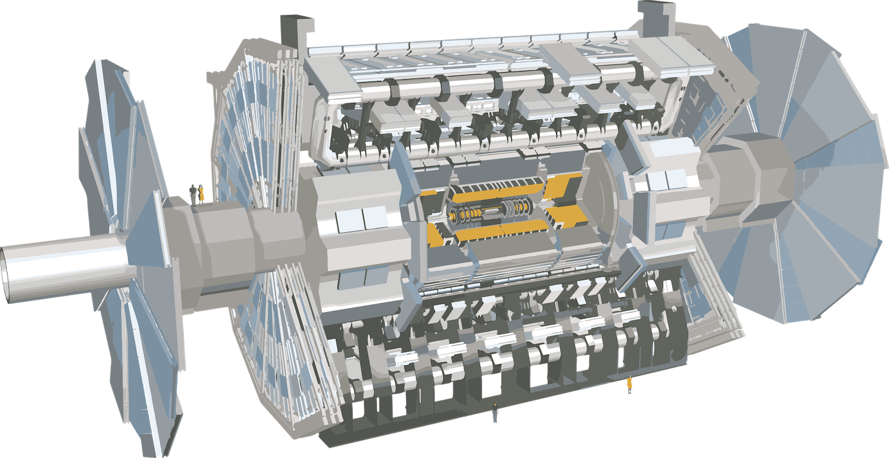

## Hi there 👋

- Currently working in the ATLAS group of JGU Mainz on LL alps.
- 🔭  Ph.D in particle Physics for the CMS experiment at CERN (2022-2025)
- Looked for long-lived particles inside the tracker of CMS as well as monitored the silicon strip tracker (https://repository.cern/records/mffn1-9fh67)

  

